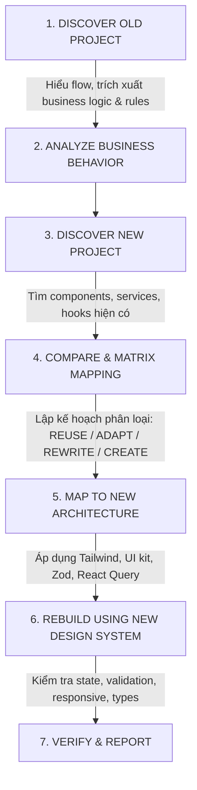

# MIGRATION GUIDE: OLD PROJECT → NEW PROJECT

> **Quy chuẩn dành cho AI Agent khi chuyển giao màn hình / tính năng từ Dự án Cũ sang Dự án Mới.**

---

## TỔNG QUAN HAI DỰ ÁN (PROJECT OVERVIEW)

| Tiêu chí | OLD PROJECT (`FE_Capnong_exe2`) | NEW PROJECT (`APRP-FE`) |
| :--- | :--- | :--- |
| **Đường dẫn** | `D:\SEP\FE_Capnong_exe2` | `D:\SEP\APRP-FE` |
| **Vai trò** | **SOURCE OF BEHAVIOR & LOGIC** | **SOURCE OF UI & ARCHITECTURE** |
| **Framework & Build** | React 19 + TypeScript + Vite 6 | React 19 + TypeScript + Vite 8 |
| **Kiến trúc thư mục** | Layer-based (`components/`, `pages/`, `services/`, `contexts/`) | Feature-driven / Domain-driven (`src/features/<feature>/`, `src/services/`, `src/components/ui/`, `src/stores/`, `src/app/router/`) |
| **Styling & Theme** | Vanilla CSS, File CSS riêng lẻ (`.css`) | Tailwind CSS v4 (`@tailwindcss/vite`, preset `tailwind.capnong-preset.js`, font `'Be Vietnam Pro'`), Design Tokens Material 3 |
| **State Management** | React Context (`src/contexts/`), local state | Server state: **TanStack React Query v5** (`@tanstack/react-query`)<br>Client state: **Zustand v5** (`src/stores/`) |
| **Form & Validation** | Tự xử lý hoặc uncontrolled/controlled cơ bản | **React Hook Form** + **Zod** schema (`schemas/`) |
| **API Client** | Fetch / Axios không chuẩn hóa | Central Axios client (`src/services/api/`), service + types riêng biệt |
| **UI Kit & Icons** | Custom vanilla + `lucide-react` | Standard UI Primitives (`src/components/ui/`: Button, Input, Modal, Drawer, Pagination, Skeleton, StateViews) + `lucide-react` |
| **Linter / Quality** | ESLint / standard | **Oxlint** + Prettier + Strict TypeScript |

---

## 1. PURPOSE (MỤC ĐÍCH MIGRATION)

Mục đích duy nhất của quy trình migration là:
1. Chuyển một feature/page từ OLD PROJECT sang NEW PROJECT một cách chuẩn mực và bền vững.
2. **Bảo tồn toàn bộ business behavior**, user flow, business rules, validation, edge cases và các trạng thái nghiệp vụ.
3. **Tái thiết kế hoàn toàn UI (Rebuild UI)** dựa trên Design System, bảng màu, typography, responsive rules và reusable components của NEW PROJECT.
4. **Tuyệt đối KHÔNG copy-paste giao diện cũ (UI) sang dự án mới.**

---

## 2. SOURCE OF TRUTH (NGUỒN SỰ THẬT)

### 2.1. OLD PROJECT là Source of Truth cho:
* **Business Logic & Rules**: Quy tắc nghiệp vụ, điều kiện hiển thị nút/hành động, công thức tính toán.
* **User Flow**: Các bước mà người dùng trải nghiệm (VD: Xem giỏ → Áp voucher → Chọn địa chỉ → Xác nhận đơn).
* **Validation**: Ràng buộc dữ liệu (bắt buộc nhập, độ dài tối đa/tối thiểu, định dạng số điện thoại, ngày tháng...).
* **Data Requirements**: Dữ liệu đầu vào cần gì và đầu ra cần hiển thị những thông tin gì.
* **States của Feature**: Loading state, Empty state, Error state, Success state, Disabled state.
* **Edge cases**: Xử lý hết hàng, huỷ ngang chừng, mạng chập chờn, dữ liệu null/undefined.
* **Tương tác liên module**: Sự phụ thuộc giữa feature này với giỏ hàng, thông báo, ví tiền, v.v.

### 2.2. NEW PROJECT là Source of Truth cho:
* **UI/UX & Visual**: Bố cục (Layout), bảng màu (Palette), typography (`Be Vietnam Pro`), khoảng cách (Spacing), bo góc (Border radius), đổ bóng (Shadows).
* **Base Components**: Button, Input, Card, Modal, Dialog, Drawer, Badge, Skeleton, Pagination, v.v.
* **Navigation & Routing**: Cấu trúc route hiện tại trong `src/app/router/index.tsx`.
* **Responsive Behavior**: Breakpoints của Tailwind CSS (`sm`, `md`, `lg`, `xl`).
* **Icons**: Bộ Lucide React theo quy chuẩn style của NEW PROJECT.
* **Architecture & File Organization**: Đặt code vào đâu trong `src/features/`, `src/services/`, `src/stores/`.
* **Current API Contracts & Models**: DTOs, interfaces đã được định nghĩa trong `src/services/*.types.ts`.

> ⚠️ **NGUYÊN TẮC BẤT DI BẤT DỊCH:**
> **KHÔNG BAO GIỜ coi OLD PROJECT là source of truth cho UI hay Styling của NEW PROJECT.**

---

## 3. CORE PRINCIPLE (NGUYÊN TẮC CỐT LÕI)

```
OLD PROJECT:
  Understand → Extract Behavior → Extract Business Rules

NEW PROJECT:
  Understand → Reuse Architecture → Reuse Components → Apply Design System

KẾT QUẢ CUỐI CÙNG:
  [OLD BEHAVIOR] + [NEW ARCHITECTURE] + [NEW UI / DESIGN SYSTEM]
```

### Điều nghiêm cấm:
❌ `COPY OLD UI (CSS/HTML/JSX) → PASTE INTO NEW PROJECT`  
❌ Mang class CSS cũ, inline styles cũ, màu sắc cũ hoặc thư viện CSS cũ vào dự án mới.

---

## 4. DISCOVERY BEFORE CODING (QUY TRÌNH KHÁM PHÁ BẮT BUỘC)

Trước khi viết bất kỳ dòng code nào cho một feature, AI **BẮT BUỘC** phải hoàn thành 10 bước Discovery:

1. **Entry Point (OLD)**: Định vị page / component khởi đầu trong `FE_Capnong_exe2/src/pages/` hoặc `routes/`.
2. **Sub-components (OLD)**: Khảo sát các component con trực thuộc màn hình đó.
3. **Services / APIs (OLD)**: Lần theo các hàm gọi API trong `FE_Capnong_exe2/src/services/`.
4. **Types / Interfaces (OLD)**: Kiểm tra các kiểu dữ liệu và response formats trong `src/types/`.
5. **Validation Rules (OLD)**: Xác định logic kiểm tra form, regex, thông báo lỗi.
6. **State Management (OLD)**: Xem feature quản lý state qua Context (`contexts/`), hook (`hooks/`) hay local state.
7. **UI States (OLD)**: Tìm hiểu cách xử lý skeleton/spinner khi loading, màn hình rỗng (empty), màn hình lỗi (error).
8. **Navigation / Routing (OLD)**: Các điều hướng sau khi submit thành công hoặc hủy.
9. **Business Rules (OLD)**: Các điều kiện ẩn/hiện nút, tính toán chiết khấu, cấm thao tác.
10. **Tương quan tại NEW PROJECT**:
    * Đã có feature folder trong `APRP-FE/src/features/<feature>/` chưa?
    * Đã có service/endpoint tương ứng trong `APRP-FE/src/services/` chưa?
    * Đã có reusable UI components nào trong `APRP-FE/src/components/ui/` có thể dùng ngay?
    * Đã có Zod schema hoặc React Query hook nào chưa?

> 🚫 **Cấm tuyệt đối**: Chỉ đọc một file UI rồi nhảy vào code ngay khi chưa hiểu hết logic đằng sau.

---

## 5. DO NOT READ THE ENTIRE SOURCE TREE (TIẾT KIỆM TOKEN & TẬP TRUNG NGỮ CẢNH)

Để tối ưu ngữ cảnh và tránh làm tràn token context:
* **KHÔNG** đọc hàng loạt toàn bộ source code của OLD PROJECT hay NEW PROJECT.
* Chỉ đọc theo chuỗi phụ thuộc có chủ đích:
  $$\text{Requested Feature} \longrightarrow \text{Entry Page} \longrightarrow \text{Components} \longrightarrow \text{Services} \longrightarrow \text{Types} \longrightarrow \text{Dependencies}$$
* **Bỏ qua các module không liên quan:**
  * Ví dụ khi migrate **Order Confirmation / Checkout**:
    * ✅ **Được đọc**: Order, Cart, Payment, Address, Voucher, Shipping services.
    * ❌ **Không đọc**: Blog, Chat, Mystery Box, Onboarding Tour, Review, Admin CMS (trừ khi có phụ thuộc trực tiếp).

---

## 6. COMPARE OLD PROJECT AND NEW PROJECT (PHÂN TÍCH ĐỐI CHIẾU)

Trước khi thực hiện, AI phải trả lời các câu hỏi và phân loại tài nguyên:

### OLD PROJECT:
* Feature nằm ở file/thư mục nào?
* Logic chính và validation đặt ở đâu?
* API nào đang được gọi? Model dữ liệu trả về ra sao?

### NEW PROJECT:
* Feature tương ứng đã có khung chưa?
* Service / DTO đã có trong `src/services/` chưa?
* Component nào trong `src/components/ui/` hoặc `src/components/common/` có thể tái sử dụng?
* Feature hook / React Query hook nào đã có sẵn?

### BẢNG PHÂN LOẠI HÀNH ĐỘNG (ACTION MATRIX):
Mỗi phần tử phải được gán vào 1 trong 5 nhãn:
* `REUSE`: Đã có sẵn ở NEW PROJECT → Sử dụng trực tiếp (VD: Button, Input, Modal, TanStack Query hooks).
* `ADAPT`: Có sẵn nhưng cần bổ sung thêm prop/phương thức để đáp ứng logic cũ mà không phá vỡ API hiện tại.
* `REWRITE`: Viết lại hoàn toàn logic cũ bằng công nghệ mới (VD: chuyển Context cũ sang Zustand/React Query; chuyển form cũ sang React Hook Form + Zod).
* `CREATE`: Chưa hề có ở NEW PROJECT → Tạo mới theo đúng convention của NEW PROJECT.
* `REMOVE`: Tính năng, code thừa, CSS inline cũ không còn phù hợp → Loại bỏ.

---

## 7. UI MIGRATION RULES (QUY TẮC CHUYỂN ĐỔI GIAO DIỆN)

1. **Chỉ dùng UI cũ làm bản thiết kế chức năng (Wireframe)**:
   * Hiểu cấu trúc phân cấp thông tin (Information hierarchy).
   * Hiểu người dùng cần nhìn thấy dữ liệu gì trước, dữ liệu gì sau.
2. **Nghiêm cấm sao chép**:
   * ❌ Không copy CSS class cũ, file `.css` cũ, màu sắc hex cũ.
   * ❌ Không copy thẻ HTML thô hoặc inline styles.
3. **Áp dụng Design System của NEW PROJECT**:
   * Sử dụng Tailwind CSS v4 với các semantic color tokens:
     * `bg-surface-bright`, `bg-surface-container`, `bg-surface-container-high`
     * `text-on-surface`, `text-on-surface-variant`
     * `bg-primary`, `text-on-primary`, `bg-primary-container`
     * `text-error`, `bg-error-container`
   * Typography: Tuân theo cấu hình font `'Be Vietnam Pro'` của dự án.
   * Spacing & Radius: Dùng utility class chuẩn của Tailwind (`rounded-lg`, `rounded-xl`, `p-4`, `p-6`, `gap-3`).
4. **Ưu tiên Reusable Components của NEW PROJECT**:
   * Nút bấm: Dùng `<Button>` từ `src/components/ui/Button` thay vì thẻ `<button>`.
   * Input/Form: Dùng `<Input>` từ `src/components/ui/Input`.
   * Popup/Hộp thoại: Dùng `<Modal>` từ `src/components/ui/Modal`.
   * Trạng thái tải/rỗng: Dùng `<Skeleton>` và `<StateViews>` từ `src/components/ui/`.

---

## 8. BUSINESS LOGIC MIGRATION (CHUYỂN ĐỔI NGHIỆP VỤ)

Business logic cũ không được copy mù quáng:
1. **Kiểm tra tính tương thích**:
   * Rule cũ có còn giá trị không?
   * NEW PROJECT đã có xử lý nghiệp vụ này ở backend hoặc service chưa?
2. **Chuyển đổi sang React Pattern của NEW PROJECT**:
   * Nếu logic cũ dùng `useEffect` gọi API trực tiếp và lưu vào `useState`:
     👉 **Chuyển thành TanStack React Query (`useQuery`, `useMutation`)** đặt trong `src/features/<feature>/hooks/`.
   * Nếu logic cũ dùng React Context phức tạp để chia sẻ state giữa các page:
     👉 **Chuyển thành Zustand store** trong `src/stores/` hoặc React Query cache.
   * Nếu logic cũ dùng validate bằng tay lộn xộn trong event handler:
     👉 **Chuyển thành Zod Schema** trong `src/features/<feature>/schemas/` kết hợp `react-hook-form`.
3. **Không tự ý thay đổi quy tắc nghiệp vụ**: Nếu thấy mâu thuẫn rule, phải báo cáo người dùng trước khi quyết định.

---

## 9. API & DATA RULES (QUY TẮC API VÀ DỮ LIỆU)

1. **Tuyệt đối không giả định `Old API = New API`**:
   * Backend của NEW PROJECT có thể đã đổi format URL, DTO (Data Transfer Object), phân trang (page/size vs offset/limit), hoặc cấu trúc bọc response (`ApiResponse<T>`).
2. **Quy tắc làm việc với API**:
   * Luôn kiểm tra file `src/services/<domain>.service.ts` và `src/services/<domain>.types.ts` của NEW PROJECT trước.
   * Nếu endpoint đã tồn tại trong NEW PROJECT: **Bắt buộc dùng service của NEW PROJECT**.
   * Chỉ thêm endpoint mới vào `src/services/` khi NEW PROJECT chưa có và API đó được xác nhận từ backend mới.
   * Mọi request phải thông qua Axios instance chung tại `src/services/api/` (xử lý auth token, refresh token, global interceptors).

---

## 10. COMPONENT REUSE HIERARCHY (THỨ TỰ ƯU TIÊN COMPONENT)

Khi cần một thành phần UI, AI phải tìm kiếm theo thứ tự ưu tiên:

1. **Priority 1**: `src/components/ui/*` (Button, Input, Modal, Drawer, Pagination, Skeleton, StateViews).
2. **Priority 2**: `src/components/common/*` hoặc `src/components/layout/*` (Header, Navbar, Footer, Breadcrumbs).
3. **Priority 3**: `src/features/<feature>/components/*` (Các component cùng domain đã được dựng trước đó).
4. **Priority 4**: Adapt (mở rộng props an toàn) cho component hiện có.
5. **Priority 5**: Tạo component mới (chỉ khi không có bất kỳ component nào đáp ứng được).

> ❌ **Không tạo Duplicate Component**: Ví dụ: Không tạo `CustomButton.tsx` hay `MyDialog.tsx` khi NEW PROJECT đã có `Button` và `Modal`.

---

## 11. ARCHITECTURE RULES (QUY TẮC KIẾN TRÚC MÃ NGUỒN)

Mọi code mới tạo ra **PHẢI TUÂN THEO 100% CẤU TRÚC CỦA NEW PROJECT**:

```
src/
├── app/
│   └── router/               # Cấu hình routes tập trung (index.tsx)
├── components/
│   ├── common/               # Shared business components (Header, Footer, Breadcrumbs)
│   ├── layout/               # Layout wrappers (MainLayout, AuthLayout, DashboardLayout)
│   └── ui/                   # Reusable UI Primitives (Button, Modal, Input, Drawer...)
├── features/
│   └── [feature-name]/       # Domain-driven feature slice
│       ├── components/       # Feature-specific components
│       ├── hooks/            # React Query hooks (useOrderQueries, useProductMutations...)
│       ├── schemas/          # Zod validation schemas
│       ├── constants/        # Hằng số riêng của feature
│       └── index.ts          # Barrel export
├── pages/                    # Route container pages (mỏng, chỉ ráp components từ features)
├── services/
│   ├── api/                  # Axios base client & interceptors
│   ├── [domain].service.ts   # API call methods
│   └── [domain].types.ts     # DTOs, interfaces, request/response models
├── stores/                   # Global state (Zustand)
├── styles/                   # Global CSS & Tailwind setup
├── types/                    # Common global TypeScript definitions
└── utils/                    # Helper functions, formatters (date, currency...)
```

---

## 12. SAFE IMPLEMENTATION (QUY TẮC AN TOÀN KHI THỰC THI)

* **Phạm vi tác động hẹp**: Chỉ chỉnh sửa hoặc tạo các file liên quan trực tiếp đến feature được yêu cầu.
* **Không đại tu toàn bộ dự án (No blind refactor)**: Không tự ý sửa cấu hình Vite, Tailwind, tsconfig hoặc các service chung không liên quan.
* **Không thêm thư viện tùy tiện**: Tận dụng tối đa bộ dependencies đã có trong NEW PROJECT (`zod`, `react-hook-form`, `@tanstack/react-query`, `zustand`, `lucide-react`, `recharts`). Không tự ý cài đặt thêm package nếu chưa có chỉ thị.
* **Không xóa code đang hoạt động**: Không xóa các components, hooks hay services cũ của NEW PROJECT khi chưa chắc chắn 100% về độ an toàn.

---

## 13. REQUIRED OUTPUT BEFORE CODING (BÁO CÁO BẮT BUỘC TRƯỚC KHI CODE)

Trước khi thực hiện viết code cho bất kỳ feature nào, AI **PHẢI** xuất ra bản kế hoạch theo cấu trúc:

```markdown
### 1. OLD PROJECT ANALYSIS
- Files phân tích: [Đường dẫn các file cũ]
- Components & Layout: [Danh sách]
- Services & Endpoints cũ: [Danh sách]
- Business Logic & Rules: [Tóm tắt rules, công thức, validations]
- Edge cases & UI States: [Loading, Error, Empty, v.v.]

### 2. NEW PROJECT ANALYSIS
- Vị trí mã nguồn tương ứng: [Thư mục features, services, pages]
- Reusable Components sẽ dùng: [Button, Modal, Input, v.v.]
- Service / APIs hiện có: [Danh sách]
- Design System tokens & Layout dự kiến: [Màu sắc, typography, card layout]

### 3. MIGRATION PLAN MATRIX
| Danh mục | OLD PROJECT (Tham khảo) | NEW PROJECT (Triển khai) | Hành động (REUSE / ADAPT / REWRITE / CREATE / REMOVE) | Ghi chú kỹ thuật |
| :--- | :--- | :--- | :--- | :--- |
| UI & Layout | OrderConfirmModal.css | Tailwind + UI Modal | REWRITE | Dùng tokens surface, primary |
| Component | CustomTable | src/components/ui/Table | REUSE | Tái sử dụng component mới |
| API Call | fetchOrder() | useOrderQuery (TanStack) | REWRITE | Chuyển sang React Query hook |
| Validation | Check thủ công | orderSchema.ts (Zod) | CREATE | Định nghĩa qua Zod |
```

---

## 14. AFTER IMPLEMENTATION CHECKLIST (KIỂM TRA VÀ BÁO CÁO SAU KHI CODE)

Sau khi code xong, AI phải tự kiểm tra:
- [ ] Feature có hoạt động đúng flow của OLD PROJECT không?
- [ ] Các business rules, validation có được giữ nguyên vẹn không?
- [ ] Giao diện có đồng nhất 100% với Design System của NEW PROJECT không?
- [ ] Đã có đầy đủ Loading state, Empty state, Error state chưa?
- [ ] Responsive hoạt động tốt trên mobile và desktop không?
- [ ] Có bị duplicate component hoặc để lại dead code không?
- [ ] Không có lỗi lint (Oxlint) và TypeScript compile error (`tsc -b`).

Báo cáo kết quả cuối cùng phải bao gồm:
```markdown
### Files Created:
- [Danh sách file mới tạo]

### Files Modified:
- [Danh sách file đã cập nhật]

### Components & Services Reused:
- [Danh sách thành phần được tái sử dụng]

### Business Logic Migrated:
- [Danh sách các rules đã chuyển đổi thành công]

### Remaining Notes / Issues (Nếu có):
- [Những điểm cần người dùng lưu ý hoặc test kỹ]
```

---

## 15. CONFLICT RESOLUTION (GIẢI QUYẾT XUNG ĐỘT)

Khi xảy ra bất đồng giữa hai dự án, tuân theo nguyên tắc phân xử sau:

| Loại xung đột | Bên chiến thắng | Nguyên tắc xử lý |
| :--- | :--- | :--- |
| **Xung đột UI / Styling** | 🏆 **NEW PROJECT WINS** | Không giữ style cũ. Áp dụng bảng màu, font, spacing của NEW PROJECT. |
| **Xung đột Kiến trúc** | 🏆 **NEW PROJECT WINS** | Đặt file vào `features/`, dùng React Query + Zustand, tuân thủ cấu trúc NEW. |
| **Xung đột Reusable Component** | 🏆 **NEW PROJECT WINS** | Ưu tiên dùng `src/components/ui/*` của NEW PROJECT. |
| **Xung đột API Contract** | 🔍 **KIỂM TRA CONTRACT MỚI** | Kiểm tra endpoint và types trong NEW PROJECT trước; chỉ gọi API theo định dạng mới. |
| **Xung đột Business Rule** | ⚠️ **DỪNG LẠI & HỎI Ý KIẾN** | Không tự đoán. Báo cáo điểm khác biệt giữa logic cũ và hệ thống mới cho người dùng. |

---

## TỔNG KẾT QUY TRÌNH THỰC HIỆN (THE GOLDEN PIPELINE)


